<!-- ═══════════════════════════ HEADER ═══════════════════════════ -->

  

  

  
  
  
  
  
  
  
  

 

<!-- ═══════════════════════════ PLAYER PROFILE ═══════════════════════════ -->

  

  <i>"From the first rough prototype to the last bit of polish, I care about one thing: <b>how the game feels in the player's hands.</b>"</i>

 

<!-- ═══════════════════════════ SHIPPED GAMES ═══════════════════════════ -->
<h2 align="center">🔥 PLAY MY GAMES</h2>

Free in your browser · no download · desktop &amp; mobile

  <a href="https://bluelolipop1.itch.io/crownfall"></a>
  <a href="https://playgama.com/game/meow-squad-zombie-defense"></a>

  <a href="https://playgama.ai/play/52uzl3cmybfyg5"></a>
  <a href="https://playgama.ai/play/3ijupm2m3kc7dl"></a>

  <a href="https://bluelolipop1.itch.io/fruit-quest"></a>
  <a href="https://bluelolipop1.itch.io/tile-trek"></a>

  <a href="https://bluelolipop1.itch.io/blobby-stack"></a>
  <a href="https://bluelolipop1.itch.io/meow-word-quest"></a>

  <a href="https://github.com/vishwaMoger/Merge-Resto"></a>

  📦 Source, trailers &amp; press kits:
  <a href="https://github.com/vishwaMoger/Crownfall-Game">Crownfall</a> ·
  <a href="https://github.com/vishwaMoger/meow-squad-zombie-defense-game">Meow Squad</a> ·
  <a href="https://github.com/vishwaMoger/SmashRush-Game">Smash Rush</a> ·
  <a href="https://github.com/vishwaMoger/Corner-Office-Game">Corner Office</a> ·
  <a href="https://github.com/vishwaMoger/FruitQuest">Fruit Quest</a> ·
  <a href="https://github.com/vishwaMoger/TileTrek">Tile Trek</a> ·
  <a href="https://github.com/vishwaMoger/blobby-stack">Blobby Stack</a> ·
  <a href="https://github.com/vishwaMoger/Meow-Word-Quest-Game">Meow Word Quest</a> ·
  <a href="https://github.com/vishwaMoger/Merge-Resto">Grandma's Main Street</a>

 

<!-- ═══════════════════════════ INVENTORY ═══════════════════════════ -->
<h2 align="center">🧰 INVENTORY</h2>

  

 

<!-- ═══════════════════════════ SKILL TREE ═══════════════════════════ -->

  

 

<!-- ═══════════════════════════ PROTOTYPES ═══════════════════════════ -->
<h2 align="center">🧪 PROJECTS &amp; PROTOTYPES</h2>

  <a href="https://github.com/vishwaMoger/Color-Maze"></a>
  <a href="https://github.com/vishwaMoger/weber_AR"></a>
  <a href="https://github.com/vishwaMoger/VishwaMoger_MiniPlatformer"></a>

  <a href="https://github.com/vishwaMoger/Dump_Truck"></a>
  <a href="https://github.com/vishwaMoger/Car_Game"></a>

 

<!-- ═══════════════════════════ SNAKE ═══════════════════════════ -->
<h2 align="center">🐍 CONTRIBUTION SNAKE</h2>

  <picture>
    <source media="(prefers-color-scheme: dark)" srcset="https://raw.githubusercontent.com/vishwaMoger/vishwaMoger/output/github-snake-dark.svg" />
    <source media="(prefers-color-scheme: light)" srcset="https://raw.githubusercontent.com/vishwaMoger/vishwaMoger/output/github-snake.svg" />
    
  </picture>

 

<!-- ═══════════════════════════ FOOTER ═══════════════════════════ -->

  

  

