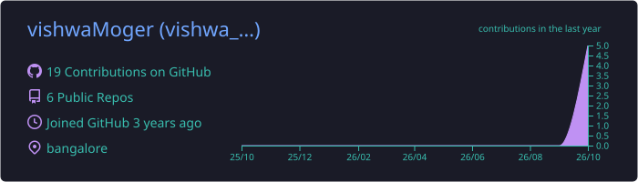
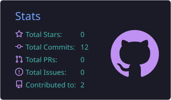
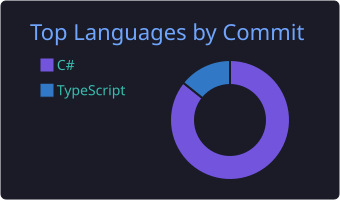

<!-- ═══════════════════════════ HEADER ═══════════════════════════ -->

  

  

  
  
  
  

 

<!-- ═══════════════════════════ PLAYER PROFILE ═══════════════════════════ -->
<h2 align="center">🎮 PLAYER PROFILE</h2>

<table align="center">
<tr>
<td width="55%" valign="top">

### 👾 About Me

I'm a **game developer** who loves turning ideas into worlds people want to play in.
From the first rough prototype to the last bit of polish, I care about one thing: **how the game feels in the player's hands.**

- 🕹️ Building games for **PC, mobile and web**
- ⚔️ Specialising in **gameplay programming** and **game feel**
- 🧪 Prototype fast, test often, polish relentlessly
- 🤝 Open to **studios, collabs and game jams**

</td>
<td width="45%" valign="top">

### 📜 Character Sheet

| | |
|:--|:--|
| **Class** | Game Developer |
| **Main Weapon** | Unity · C# |
| **Secondary** | TypeScript · Web |
| **Specialty** | Gameplay & Game Feel |
| **Platforms** | PC · Mobile · Web · AR |
| **Home Base** | Bangalore, India |
| **Current Quest** | Shipping my next game 🚀 |

</td>
</tr>
</table>

 

<!-- ═══════════════════════════ INVENTORY ═══════════════════════════ -->
<h2 align="center">🧰 INVENTORY</h2>

<b>Engines & Languages</b>

  

<b>Tools & Platforms</b>

  

 

<!-- ═══════════════════════════ SKILL TREE ═══════════════════════════ -->
<h2 align="center">🌳 SKILL TREE</h2>

<table align="center">
<tr>
<td align="center" width="33%">
  <h3>🎮</h3>
  <b>Gameplay Programming</b> 
  Player controllers, mechanics, AI, game systems and progression
</td>
<td align="center" width="33%">
  <h3>✨</h3>
  <b>Game Feel & Polish</b> 
  Juicy feedback, particles, camera, tweens and sound
</td>
<td align="center" width="33%">
  <h3>🖥️</h3>
  <b>UI / UX</b> 
  Menus, HUDs and clean, readable game interfaces
</td>
</tr>
<tr>
<td align="center" width="33%">
  <h3>📱</h3>
  <b>Multi-Platform</b> 
  Building and optimizing for PC, mobile and browsers
</td>
<td align="center" width="33%">
  <h3>🕶️</h3>
  <b>AR / XR</b> 
  Augmented reality experiences for Android and iOS
</td>
<td align="center" width="33%">
  <h3>📝</h3>
  <b>Game Design</b> 
  Core loops, level design and design documents
</td>
</tr>
</table>

 

<!-- ═══════════════════════════ STATS ═══════════════════════════ -->
<h2 align="center">📊 PLAYER STATS</h2>

  

  
  

  

 

<!-- ═══════════════════════════ SNAKE ═══════════════════════════ -->
<h2 align="center">🐍 CONTRIBUTION SNAKE</h2>

  <picture>
    <source media="(prefers-color-scheme: dark)" srcset="https://raw.githubusercontent.com/vishwaMoger/vishwaMoger/output/github-snake-dark.svg" />
    <source media="(prefers-color-scheme: light)" srcset="https://raw.githubusercontent.com/vishwaMoger/vishwaMoger/output/github-snake.svg" />
    
  </picture>

 

<!-- ═══════════════════════════ FOOTER ═══════════════════════════ -->

  

  

