<!-- ═══════════════════════════ HEADER ═══════════════════════════ -->

  

  

  
  
  
  
  

 

<!-- ═══════════════════════════ PLAYER PROFILE ═══════════════════════════ -->

  

  <i>"From the first rough prototype to the last bit of polish, I care about one thing: <b>how the game feels in the player's hands.</b>"</i>

 

<!-- ═══════════════════════════ INVENTORY ═══════════════════════════ -->
<h2 align="center">🧰 INVENTORY</h2>

  

 

<!-- ═══════════════════════════ SKILL TREE ═══════════════════════════ -->

  

 

<!-- ═══════════════════════════ SNAKE ═══════════════════════════ -->
<h2 align="center">🐍 CONTRIBUTION SNAKE</h2>

  <picture>
    <source media="(prefers-color-scheme: dark)" srcset="https://raw.githubusercontent.com/vishwaMoger/vishwaMoger/output/github-snake-dark.svg" />
    <source media="(prefers-color-scheme: light)" srcset="https://raw.githubusercontent.com/vishwaMoger/vishwaMoger/output/github-snake.svg" />
    
  </picture>

 

<!-- ═══════════════════════════ FOOTER ═══════════════════════════ -->

  

  

